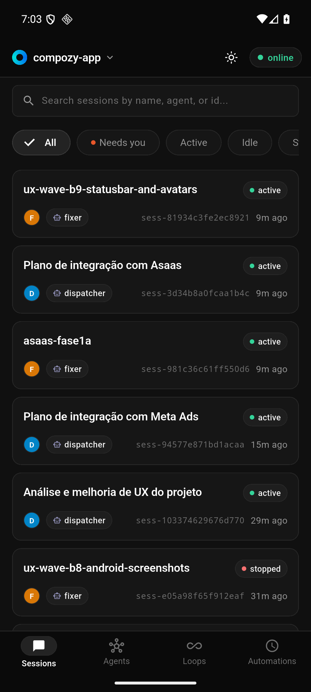
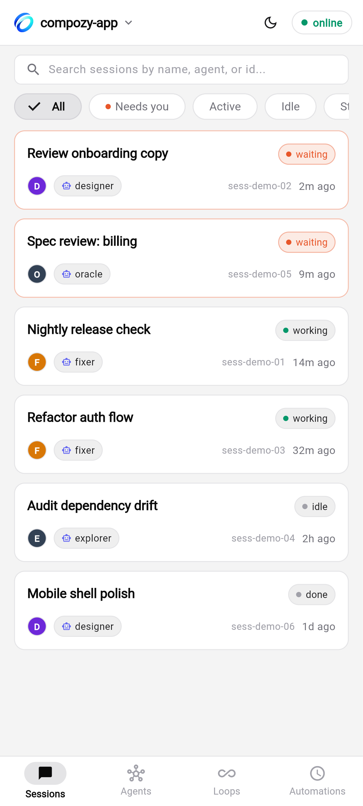
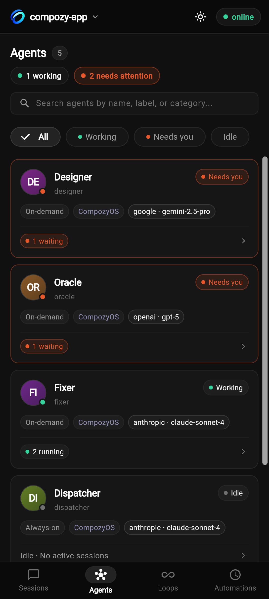
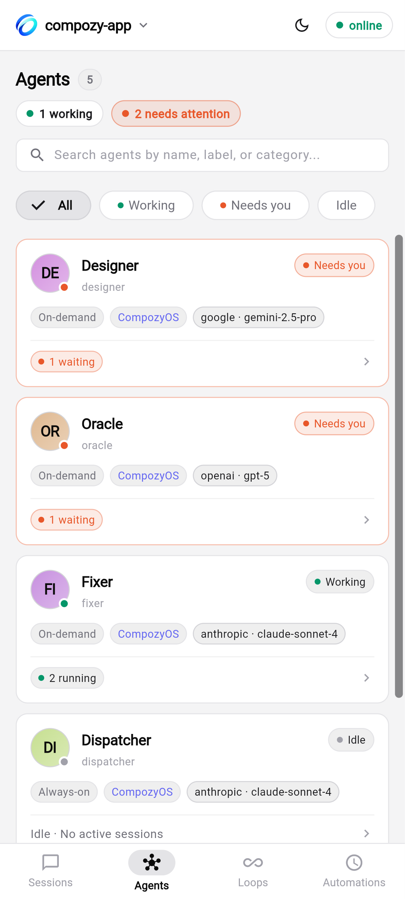
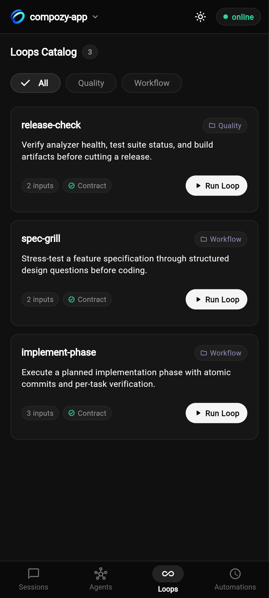
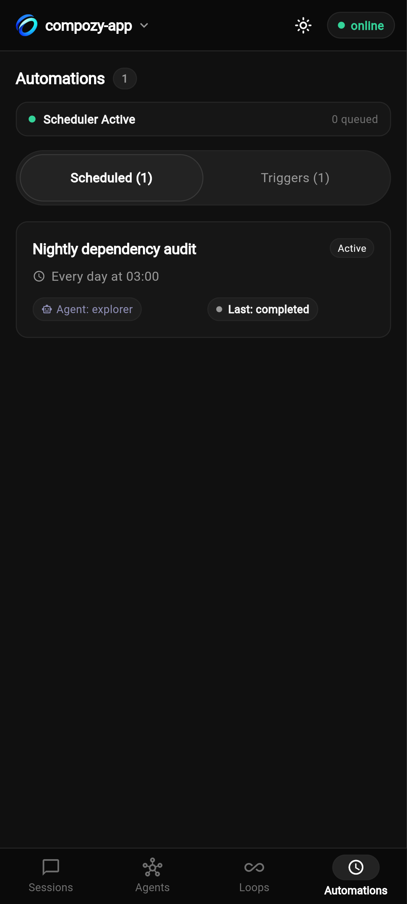
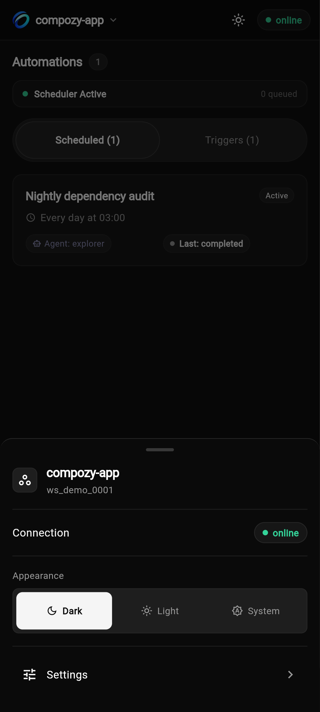
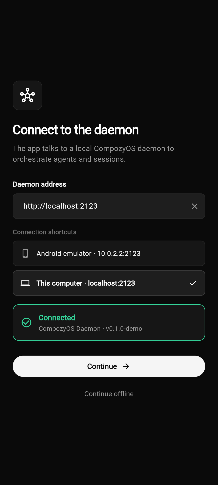

# compozy-app

Flutter client for a local [CompozyOS](https://github.com/compozy) daemon — sessions, agents, Loops, and Automations.

[](#)
[](https://flutter.dev)
[](LICENSE)
[](.github/workflows/ci.yml)

> **Beta software:** `compozy-app` is an early **beta** client for a local CompozyOS daemon. The daemon API surface, navigation, and UI are actively evolving and may change without notice.

## What It Is

`compozy-app` is a cross-platform Flutter client (Android, desktop, and web) for monitoring and interacting with a local CompozyOS daemon. It provides:

- **Sessions & live chat:** Browse active and recent sessions across workspaces, inspect transcripts, stream live agent output over Server-Sent Events (SSE), send prompts, view subagent hierarchies and tool-call pills, and approve or reject pending actions.
- **Agent presence:** View registered agents, current status (`Needs you`, `Working`, `Idle`), active session counts, effective runtime details, and recent activity.
- **Loops catalog:** Browse available Loops by category, inspect definitions and inputs, and trigger Loop runs.
- **Automations:** Inspect scheduled jobs, triggers, run history, and scheduler status, with manual job triggering and run cancellation.
- **Theming:** High-contrast dark and light themes built from CompozyOS design tokens (`CompozyPalette`).

## Screenshots

| Dark Mode | Light Mode |
| --- | --- |
|  |  |
|  |  |

| Loops (Dark) | Automations (Dark) |
| --- | --- |
|  |  |

| Workspace Menu (Dark) | Connect Screen (Dark) |
| --- | --- |
|  |  |

## Requirements

- **Flutter SDK** (stable channel) with **Dart SDK `^3.14.0`** (per `pubspec.yaml`)
- A running **CompozyOS daemon** reachable from the target device:
  - Desktop / Web default: `http://localhost:2123`
  - Android emulator default: `http://10.0.2.2:2123`
  - On Android, loopback hosts (`localhost`, `127.0.0.1`, `[::1]`) are automatically normalized to `10.0.2.2` while preserving port and path. On physical mobile devices on a local network, enter your host machine's LAN IP.

## Getting Started

1. Clone the repository:

   ```bash
   git clone https://github.com/carlosedsousa-dev/compozy-app.git
   cd compozy-app
   ```

2. Install dependencies:

   ```bash
   flutter pub get
   ```

3. Run the app on your target device:

   ```bash
   flutter run -d <device>
   ```

4. On first launch, the **connect screen** (`DaemonSetupScreen`) prompts you for your daemon base URL and verifies reachability (`GET /api/openapi.json`) before entering the main app shell.

## Configuration

Settings are persisted locally on-device using `shared_preferences` (`SettingsRepository`):

- **Base URL:** Defaults per platform (`http://10.0.2.2:2123` on Android; `http://localhost:2123` on desktop and web).
- **App / API Token (optional):** Sent as an `Authorization: Bearer <token>` header when configured.
- **Active Workspace ID & Theme Mode:** Stored alongside connection preferences (`ThemeMode.dark` by default, switchable between dark, light, and system).
- **First-run connect screen:** Validates HTTP/HTTPS URL format, offers quick shortcuts for Android emulator (`10.0.2.2:2123`) and local host (`localhost:2123`), tests `GET /api/openapi.json`, and persists `hasConfirmedConnection` once connected.
- **Continue offline:** The connect screen includes a **Continue offline** bypass that enters the app shell for the current session without marking the connection as confirmed in persistent settings.

## Architecture

The codebase separates shared core infrastructure from feature modules using Riverpod (`flutter_riverpod`) and `dio`:

- `lib/core/`
  - `theme/` — `CompozyPalette` (dark/light semantic tokens), `CompozyTheme`, and theme mode toggle.
  - `network/` — `CompozyApiClient` (Dio REST wrapper + platform URL normalization), `HealthChecker` (`/api/openapi.json`), `SseClient` (SSE parser and reconnection), and API exception mapping.
  - `settings/` — `Settings` model and `SettingsRepository` / `SettingsNotifier` backed by `shared_preferences`.
  - `presentation/` — Responsive `AppNavigationShell` (mobile bottom bar `< 600dp`, desktop rail `>= 600dp`), `WorkspaceMenuSheet`, and shared empty/error/skeleton widgets.
- `lib/features/<feature>/{domain,data,presentation}/`
  - `connection/` — First-run `ConnectionGate`, `DaemonSetupScreen`, and offline `ConnectionBanner`.
  - `sessions/` — Session board/list, live SSE chat, prompt bar, approvals, subagent drawer, and tool execution pills.
  - `agents/` — Agent catalog, session-derived presence, details sheet, and activity metrics.
  - `loops/` — Loops catalog, category filtering, detail view, and run sheet.
  - `automations/` — Scheduled jobs, triggers, run history, cron translation, and scheduler health.
  - `settings/` — Daemon URL, token, workspace ID, live connection test, and theme controls.

Visual tokens and screen specifications are documented in [`docs/design/REFERENCE_GUIDE.md`](docs/design/REFERENCE_GUIDE.md).

## API Surface Consumed

Verified from `lib/core/network/` and `lib/features/*/data/`:

| Domain | Endpoints |
| --- | --- |
| Health / Discovery | `GET /api/openapi.json` |
| Sessions & Streaming | `GET /api/sessions`, `GET /api/sessions/{id}`, `GET /api/sessions/{id}/history` (or `/api/workspaces/{wsId}/sessions/{id}/history`), `GET /api/sessions/{id}/stream` (or `/api/workspaces/{wsId}/sessions/{id}/stream`), `GET /events` (SSE), `POST /api/sessions/{id}/prompt` (or workspace-scoped), `POST /api/sessions/{id}/approve` (or workspace-scoped) |
| Agents | `GET /api/agents`, `GET /api/agents/{name}/activity` (presence is derived client-side by joining `/api/agents` with `/api/sessions?all_workspaces=true`) |
| Loops | `GET /api/loops`, `GET /api/loops/{name}`, `POST /api/loops/run` |
| Automations & Scheduler | `GET /api/automation/jobs`, `GET /api/automation/jobs/{id}`, `GET /api/automation/jobs/{id}/runs`, `POST /api/automation/jobs/{id}/trigger`, `GET /api/automation/runs`, `POST /api/automation/runs/{id}/cancel`, `GET /api/automation/triggers`, `GET /api/scheduler` |

This client is **read-mostly**: besides sending session prompts, responding to approvals, and starting a Loop run (`POST /api/loops/run`), triggering an automation job (`POST /api/automation/jobs/{id}/trigger`) and cancelling an automation run (`POST /api/automation/runs/{id}/cancel`) are the only mutations.

## Testing

Run static analysis and the test suite:

```bash
flutter analyze
flutter test
```

Current baseline: `flutter analyze` reports **0 issues** and `flutter test` passes **241 tests**, including end-to-end widget flows in [`test/e2e/live_flow_test.dart`](test/e2e/live_flow_test.dart) and [`test/e2e/live_flow_v2_test.dart`](test/e2e/live_flow_v2_test.dart) (mocked HTTP/SSE daemon journeys covering connection setup, sessions, live streaming chat, approvals, subagent drawer, Loops execution, settings, and theme switching).

## CI/CD

- **CI ([`.github/workflows/ci.yml`](.github/workflows/ci.yml)):** Runs `flutter analyze` and `flutter test --reporter expanded` on every push and pull request targeting `main`, and builds the release web bundle (`flutter build web --release`).
- **Release CD ([`.github/workflows/release.yml`](.github/workflows/release.yml)):** Triggers on annotated `vX.Y.Z` or pre-release `vX.Y.Z-<suffix>` tags (or manual `workflow_dispatch` with an existing tag). It runs a guard verifying the annotated tag, `main` ancestry, `pubspec.yaml` / `kAppVersion`, and [`CHANGELOG.md`](CHANGELOG.md) heading, re-runs static analysis and tests, builds the release Android APK and web bundle (`zip`), and publishes a GitHub Release (marked as a pre-release for `-<suffix>` tags) with notes extracted from [`CHANGELOG.md`](CHANGELOG.md). Release APKs are signed with the project release keystore supplied through four repository secrets (`ANDROID_KEYSTORE_BASE64`, `ANDROID_KEYSTORE_PASSWORD`, `ANDROID_KEY_ALIAS`, `ANDROID_KEY_PASSWORD`), and the build verifies the signature and fails rather than publishing an improperly signed APK.

## Contributing

See [`CONTRIBUTING.md`](CONTRIBUTING.md) for prerequisites, the required verification gate, commit conventions, and screenshot data rules.

## Security

See [`SECURITY.md`](SECURITY.md) for private vulnerability reporting instructions and security scope notes.

## Versioning

`compozy-app` follows [Semantic Versioning 2.0.0](https://semver.org/spec/v2.0.0.html). The authoritative package version lives in `pubspec.yaml` and is mirrored in [`lib/core/app_info.dart`](lib/core/app_info.dart) (enforced by [`test/core/version_test.dart`](test/core/version_test.dart)).

- **Pre-1.0 rules:** While `MAJOR` is `0`, **breaking** changes and new features bump `MINOR` (`0.1.0` -> `0.2.0`), and fixes bump `PATCH`. Once `1.0.0` is released, standard SemVer (`MAJOR.MINOR.PATCH`) applies.
- **Release tags & build metadata:** Releases use annotated git tags `vX.Y.Z` matching the package version. The `+N` build suffix in `pubspec.yaml` is metadata for CI/store builds and must never be used to compare compatibility.
- **Daemon independence:** The client is versioned independently of the CompozyOS daemon and does not mirror daemon versions. Compatibility is defined by [API Surface Consumed](#api-surface-consumed); daemon-side changes that break that surface are treated as breaking changes here.
- **Deprecations:** A `MINOR` release may deprecate an API or UI surface; removal happens no earlier than the next `MINOR` pre-1.0 (`MAJOR` after `1.0`).
- **Reporting issues:** Check the version in **Settings -> About** (or include the git tag/build you ran) when filing bug reports.

## License

Released under the [MIT License](LICENSE).
